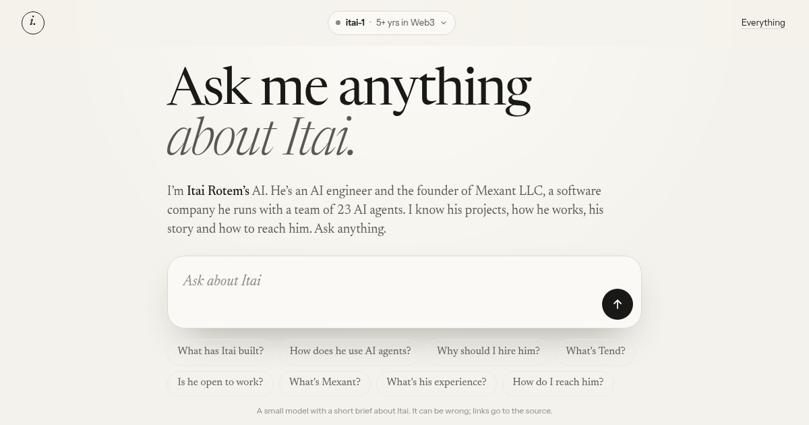
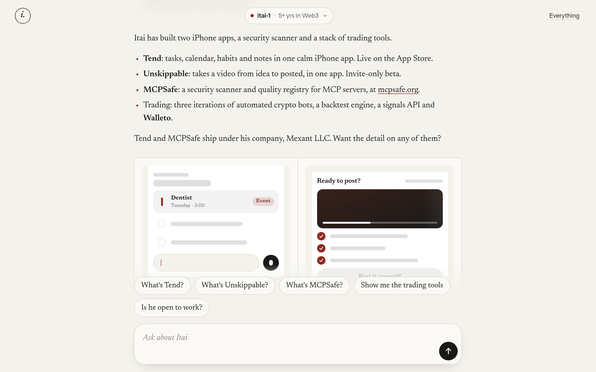
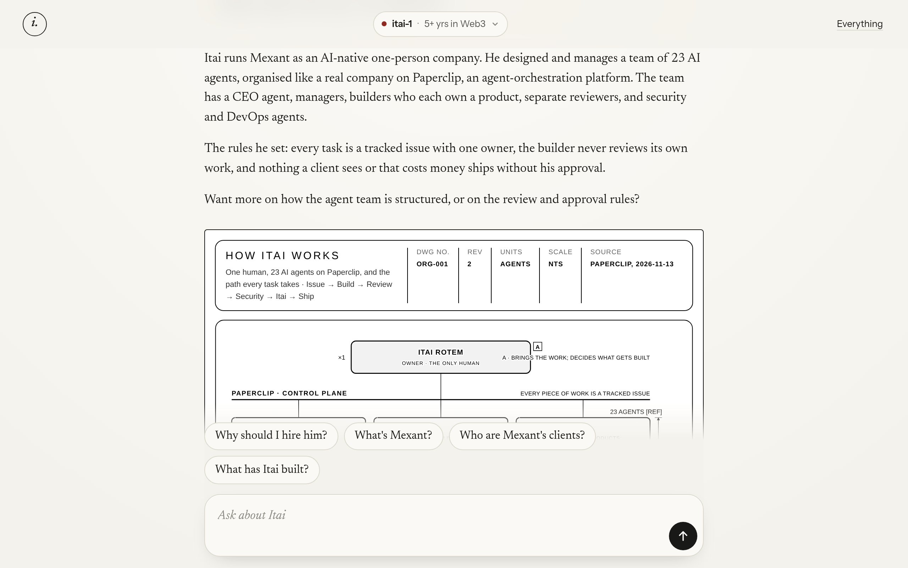

# itairotem.com: ask Itai's AI

My personal site, rebuilt as a conversation. Instead of a page of sections, you ask a small AI
about me (my projects, how I run my company with a team of AI agents, my story, how to reach me)
and it answers in a few sentences, with a visual "plate" under the words when one helps: project
cards, an org drawing of the agent team, a timeline, a contact card.

**Live:** [itairotem.com](https://itairotem.com)



The earlier version of this repo (a 3D portfolio in Next.js and Three.js) is kept on the
[`v1-3d-portfolio`](../../tree/v1-3d-portfolio) branch and the `v1` tag.

## What's in here

| Folder | What it is |
|---|---|
| [`site/`](site) | The front end. Plain HTML, CSS and JavaScript, no framework, no build step, no dependencies. Served as static assets by a Cloudflare Worker. |
| [`api/`](api) | The backend. A Cloudflare Worker in TypeScript that streams answers from Claude, with per-visitor limits, a daily spend cap and an output guard. |

## How it works

1. You type a question. The front end sends the visible conversation (`POST /chat`) to the API.
2. The API builds a system prompt from a short persona ([`api/src/persona.ts`](api/src/persona.ts))
   and one knowledge file ([`api/pack.md`](api/pack.md)). **That file is the only thing the model
   knows about me.** No tools, no browsing, no database. If a fact isn't in the pack, the model is
   told it doesn't exist.
3. The answer streams back as Server-Sent Events. The front end reveals it word by word at a steady
   pace, rendering bold, lists and links as they arrive, and attaches the matching plate.
4. If the model is unavailable, rate-limited or over budget, the site falls back to scripted
   answers written from the same facts ([`site/public/shared/answers.js`](site/public/shared/answers.js)),
   with a one-line note. It never hangs on a spinner.



## The AI: model, caps and guard

- **Model:** Claude Haiku 5.5 through the Anthropic Messages API. The system prompt (~11k tokens)
  is prompt-cached, so a typical answer costs about $0.0004.
- **Per-visitor limits:** 20 questions an hour and 60 a day per IP (IPv6 grouped by /64, stored only
  as a salted hash). Refused requests don't count.
- **Global daily spend cap:** $2 per UTC day by default. Before each call, a single SQLite-backed
  Durable Object reserves the request's worst-case cost and refuses if it would pass the cap, so a
  burst of parallel requests can't overshoot. After the stream ends the reservation is swapped for
  the real cost from the API's usage numbers. See [`api/src/limits.ts`](api/src/limits.ts).
- **Output guard:** [`api/src/guard.ts`](api/src/guard.ts) scans the stream as it goes, across chunk
  boundaries, and removes key- or token-shaped strings, any email except mine, and any link or bare
  domain that isn't on the allowlist of my public pages. A prompt-injected answer can't hand out a
  foreign link.
- **Persona rules:** it speaks as my AI, never as me; it doesn't invent numbers, dates or clients;
  it doesn't discuss prices or money; clients stay anonymous.
- **CORS:** only `itairotem.com`, `www.itairotem.com` and the preview host. Not a security boundary
  (any script can set `Origin`); the limits are.
- **Logs:** counts only (tokens, cost, guard hits, latency). No message text, no IPs.

## Indexing

The preview host is `noindex` everywhere (header, meta tag, `robots.txt`). The production config
([`site/wrangler.prod.jsonc`](site/wrangler.prod.jsonc)) puts a tiny Worker
([`site/src/worker.js`](site/src/worker.js)) in front of the static files that lifts all three only
when the request's host is `itairotem.com` or `www.itairotem.com`.

## How it was built

I run [Mexant](https://www.mexant.com), a software company, with a team of 23 AI agents organised
like a company on Paperclip, an agent-orchestration platform: a CEO agent, managers, builders who
each own a product, separate reviewers, and security and DevOps agents. This site was built the
same way as everything else there:

- I set the direction and picked the design from three rendered concepts (a printed interview, a
  console, a "small model" page).
- A manager agent scoped the work into tracked issues with a scope fence and a run budget.
- Builder agents wrote the front end and the API. A different agent reviewed every change, a
  security agent reviewed the API (limits, guard, CORS), the model was tested with jailbreak and
  leak prompts before launch, and nothing went live without my OK.
- The design passes followed a fixed toolkit: motion rules (opacity-only word reveal, one entrance,
  reduced motion collapses every choreography), an anti-slop copy pass, and a dimensional-drawing
  style for the org sheet.



## Run it yourself

**API** (`api/`, Node 24, Wrangler):

```sh
cd api
npm test                                  # guard, IP bucketing and CORS unit tests, no dependencies
npx wrangler secret put ANTHROPIC_API_KEY # your own key
npx wrangler deploy                       # STUB=1 in wrangler.jsonc streams canned answers, no model calls
```

`scripts/burst.sh` fires parallel requests at a deployed copy to check the limits;
`scripts/transcript.py` asks 16 questions (8 normal, 8 jailbreak and leak attempts) and prints a
markdown transcript.

**Site** (`site/`):

```sh
cd site
node --test test/worker.test.mjs  # the host-based indexing rules
sh scripts/deploy.sh              # preview config, noindex everywhere
sh scripts/deploy.sh prod         # production config, indexable on itairotem.com only
```

Point `API` in `site/public/shared/model.js` at your own API host. `scripts/shoot.mjs` drives headless
Chrome over the DevTools protocol for screenshots and checks (with the API mocked, so no questions
are spent); `scripts/og.mjs` renders the link-preview image.

## Stack

Cloudflare Workers (static assets, Durable Objects with SQLite), TypeScript, plain HTML/CSS/JS,
the Anthropic Messages API (Claude Haiku 5.5, streaming, prompt caching), Server-Sent Events,
headless Chrome over CDP for screenshots. Fonts: Newsreader and Instrument Sans (SIL Open Font
License), self-hosted.

## Contact

[itairotem23@gmail.com](mailto:itairotem23@gmail.com) · [@itaiwins](https://twitter.com/itaiwins)
